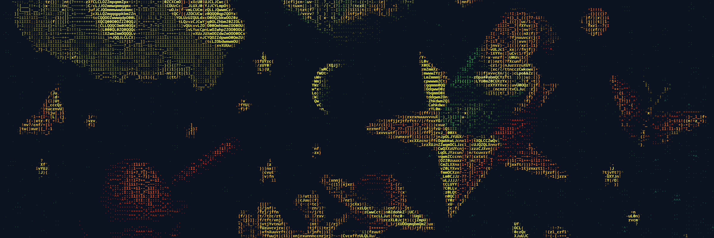
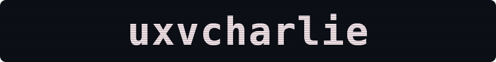


<a href="https://uxvcharlie.github.io/Rock-n-Bot/">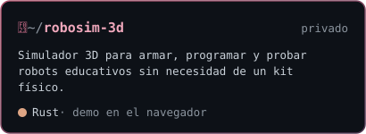</a>
<a href="https://github.com/uxvcharlie/imagen-a-ascii">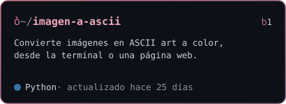</a>
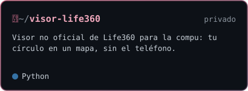
<a href="https://github.com/uxvcharlie/uamvirtual-calendario">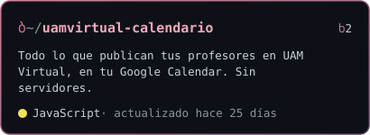</a>

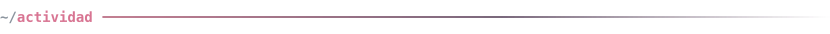

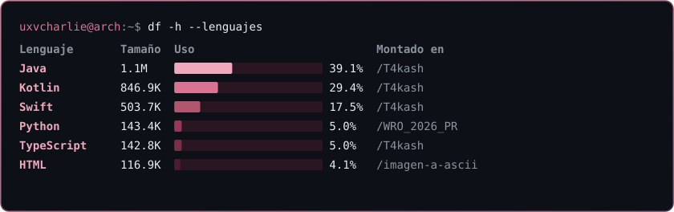

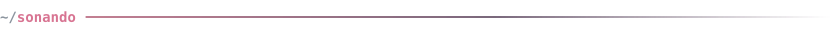

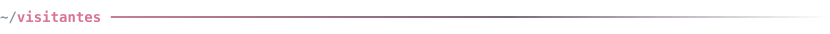

<a href="https://github.com/uxvcharlie/uxvcharlie/issues/new?title=firmar&body=Firmo+el+muro+de+visitantes.">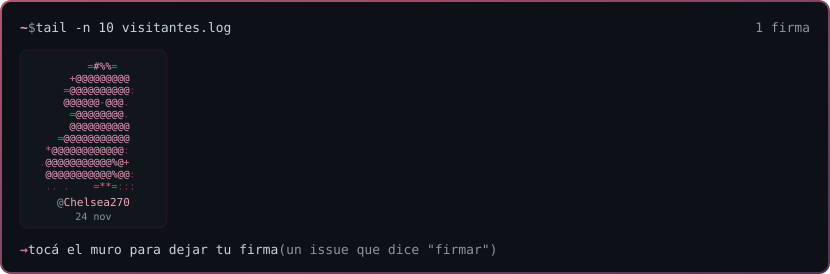</a>

